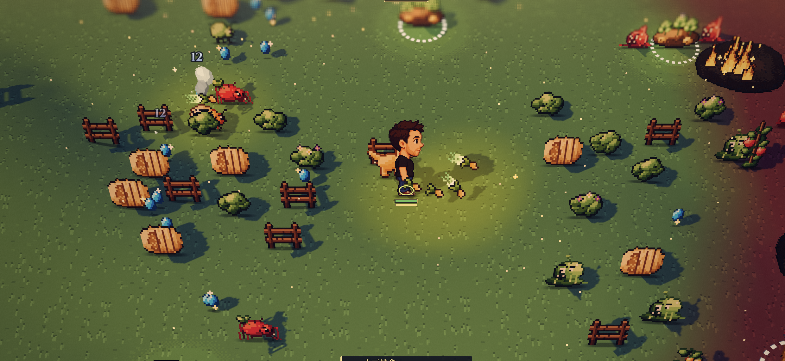
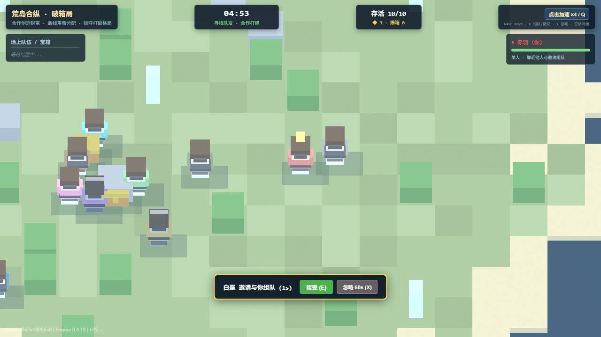
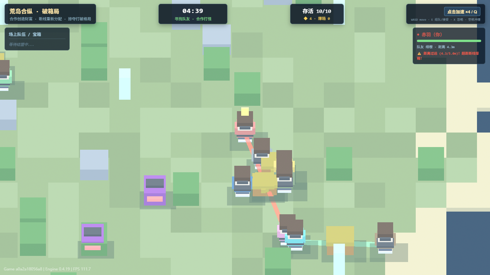

# 《荒岛分赃》Review 修复与更名执行计划

日期：2026-11-05。状态：已完成全部修复并通过全量验证（R01-R12 已闭环）。

审查基线：`114bc5d585ee6be298b6ae3dabe7a039697343d3`。

审查对象：视觉改造提交 `a0a2a18`、玩法修改提交 `114bc5d`，以及对应的两份计划。

## 1. 结论与执行边界

**两份计划已经落地了主要架构和部分规则，但不能据此判定全部完成。** 当前还有会丢失宝物、破坏组队选择、改变结算后状态、导致重开场景不恢复的缺陷；现有浏览器验收脚本也存在假通过。

本次用户确认游戏正式更名为 **《荒岛分赃》**。执行者应同时修复下述问题和更新对应文案。

保留已有原生 ForgeaX 场景、正交镜头、Plugin 装配和模拟模块，不回退到独立 Canvas。保留已确认的两人组队、双向邀请、忽略 60 秒、4.0 预警、严格超过 5.0 断线、中点爆箱和公共争抢规则，不恢复 F 踢箱。

本计划只要求针对性修复与补齐交付。不要换引擎、升级依赖、增加联机、账号、职业、装备或通用框架。建议由一个执行 AI 串行修改这些重叠模块，完成每个阶段后再进入下一阶段。

## 2. 本轮实际检查与证据

### 已执行

- 当前提交及工作树检查；开始审查时工作树干净。
- 阅读模拟、Plugin、呈现、资产包、HUD、样式、测试、试玩脚本、元数据及设计文档。
- `pnpm.cmd test`：**11 个套件、57 项通过**，其中新合作/背叛模拟测试为 9 项。
- `pnpm.cmd typecheck`：通过。
- 直接导入当前 `simulation.ts`，在内存测试夹具中调用真实模拟函数复现缺陷，未修改生产源码。
- 检查已有 `play.json`、`capture.json` 和截图；保存关键证据副本，防止后续试玩覆盖。

[完整审查证据 JSON](../reviews/2026-11-05-review-evidence.json)包含提交号、复现数值、检查范围和已有报告的最终状态。

### 验证限制

- 本轮 `project check` 数分钟没有返回结果，已终止本轮创建的该命令；**本轮未确认其通过**，不能沿用 README 的“通过”替代。
- 本轮没有重新执行完整浏览器试玩；画面判断来自已有截图与当前呈现代码。已有截图不视为本轮新验收，也不证明全部来自最终提交的干净构建。
- 没有移动端真机、新机器安装、平台发布或比赛资格核验。
- 57 项测试通过说明现有断言通过，不代表下述场景已被测试覆盖。

### 已有成果可以保留

| 内容 | 判断 |
| --- | --- |
| 原独立 Canvas 退役，逻辑提取为 TypeScript 模拟并由原生 Plugin 驱动 | 已落地 |
| 原生近景正交相机、地面、角色、箱体、脚底影、合作连线和预警色 | 基础呈现已落地，视觉细节仍不完整 |
| 单方邀请不直接成队，接受后建立互指关系，交叉邀请只建一箱 | 基础规则已落地 |
| 忽略记录按无序角色对双向生效、60 秒到期后可重新邀请 | 基础规则已落地，候选选择、重复忽略和输入校验有缺陷 |
| 严格超距解散、使用实时中点、距离解散释放财物、去掉实际踢箱路径 | 基础规则已落地，移动后淘汰优先级和显示容量有缺陷 |
| 全流程试玩、移动端、财富收益和事件反馈 | 尚不能判定完成 |

## 3. 修复清单总览

P1：先修，会直接破坏核心规则、状态或验收可信度。P2：随后修，补齐已承诺行为和呈现。编号供执行者逐项回报，不是要求重构所有模块。

| 编号 | 级别 | 问题 | 主要位置 |
| --- | --- | --- | --- |
| R01 | P1 | 外部攻击把箱体打到零血后，不掉宝、不清财物、不增加爆箱数 | `simulation.ts:431–438, 994–1003` |
| R02 | P1 | 结算后仍移动、战斗、拾取，甚至能杀死已确定的胜者 | `simulation.ts:789–1088` |
| R03 | P1 | 重开只重置模拟，地块/道具世界变换不恢复；R 重开不关闭结算层 | `presentation.ts:127–145`、`guide-controller.ts:223–227, 373–393` |
| R04 | P1 | 重复忽略延长屏蔽，忽略最近角色后挡住其他可选角色 | `simulation.ts:226–238, 580–604, 840–843` |
| R05 | P1 | 普通合作 AI 为追远处宝物拉断线；移动后先断线、下一步才判坠落 | `simulation.ts:688–701, 831–837, 899–926` |
| R06 | P1 | 固定 48 个可见掉落槽不足，超过数量的宝物可拾取但不可见 | `art.pack.ts:555–568`、`presentation.ts:278–298` |
| R07 | P1 | 试玩吞掉失败，空箱爆炸/无缩圈也能被报告为全流程通过 | `scripts/playthrough.mjs`、根 README 的验收声明 |
| R08 | P2 | 同一角色能收到多条邀请；发起者可覆盖旧邀请；快捷键目标与屏幕目标不一致 | `simulation.ts:523–565`、`island.pack.ts:282–309` |
| R09 | P2 | 合作/个人宝物的攻击收益缺失，另加入未在计划中的 40 秒免战与怪物绝对优先 | `simulation.ts:939–940, 960–1009` |
| R10 | P2 | 组队列表恒为空、缺少自己箱体数据，胜负/名次显示不可靠，触屏与旧模板控制混杂 | `guide-controller.ts`、`guide.ui.*`、`island.pack.ts` |
| R11 | P2 | 目标视觉与反馈仍有缺口：像素数据未使用、朝向/动画/受击/粒子没有接入 | `pixel-art-data.ts`、`art.pack.ts`、`presentation.ts` |
| R12 | P2 | 产品名称、操作说明、模板 README 与设计案互相矛盾 | `forge.json`、HUD、两份 README、`GAME_DESIGN.md` |

路径默认相对 `forgeax-game/assets/island/`；UI、脚本和根文档另有注明。行号以审查提交为准，执行时按函数定位。

## 4. R01：外部致命攻击必须真正释放箱内财物

### 已确认的复现

安排一支两人队，箱内 5 份财物、箱体 HP=12，由外敌通过正常自动攻击分支造成 12 点伤害。

当前结果：`hp=0`、`treasure=5`、公共掉落价值 `0`、爆箱次数 `0`，原队关系保留。

根因：攻击分支先执行 `c.hp -= 12`，随后 `destroyChest()` 因 `hp <= 0` 直接返回。宝物永远留在无效箱体里。现有“外部掠夺”测试直接调用仍有血的 `destroyChest()`，没有覆盖致命攻击入口。

### 最小修复

- 致命伤害进入一次性破箱入口；调用方不能先让存活检查失效再要求该入口发放财物。
- 保持非致命伤害、箱体受击、关系保留规则。
- 同一箱体只释放原剩余价值一次、清空财物、标无效、计数一次；以后距离解散不能第二次发放。
- 不采用“零血量也无条件再散落”的补丁，否则重复调用会产生重复反馈或计数。

### 验收

通过真实攻击路径验证：HP 恰好扣到零、越过零、非致命伤害、同一帧外部攻击与断线，以及之后的重复清理。N=5 时总发放价值恰好为 5，关系仍互指。

## 5. R02：结局后冻结玩法，结算读取权威结果

### 已确认的复现

`gameOver=true` 后调用普通 `stepSimulation()`，玩家仍会移动。在另一夹具中，已经记录的胜者被结算后的攻击打到 HP=0，`winner` 仍指向这个已死亡角色。

原因是 `!sim.gameOver` 只包住了计时/缩圈和最后的结局判断；中间输入、AI、移动、战斗和拾取仍执行。

### 最小修复

- 结局后只接受合法重开和必要的纯显示过渡；位置、存活、财物、关系、伤害、计数、胜者和最终排名不再变化。
- 重开输入处理之后，在模拟入口明确结束已完成对局的规则推进，不能分散给每个子分支补零碎判断。
- HUD 使用实际 `winnerId === playerId` 判断胜利；当前 `isAlive` 不能代表获胜。
- 记录玩家被淘汰时的真实名次，或使用明确的结算字段。当前 `11 - 最终存活人数` 会把许多失败都算成第十，甚至把早期淘汰算成第二。
- “时间到而多人存活”的当前胜者来源要如实记录，不自行增加积分胜负系统；至少界面必须与模拟选定的胜者一致，不能因为还活着就展示冠军。

### 验收

结局后继续输入移动/冲撞/邀请/忽略，推进若干秒，关键状态保持不变；胜者仍存活且结果不变化。覆盖玩家获胜、玩家失败、无人存活及超时多人存活的 HUD 一致性。名次用淘汰顺序核验，不使用最终 aliveCount 猜测。

## 6. R03：重开恢复完整世界与 UI

### 源码确认

`restartSimulation()` 用新模拟数据覆盖旧对象，但 `presentation.update()` 只在地块 `gone` 或 `falling` 时写 Transform，没有恢复健康地块的分支。已被放到 Y=-999 的地块/道具在重开后仍可能不见，而模拟认为其是陆地。

结算层只在按钮点击回调中主动隐藏。按 R 重开改变了模拟，但 HUD 没有在 `gameOver=false` 时隐藏弹窗，可能继续挡住新对局。

### 最小修复

- 以原始场景变换恢复地块/道具；复用缓存的初始姿态或显式的重开同步，不为每类物体另造一套状态。
- 重开同步相机、角色、箱体、连线和显示槽，不能把重置模拟当成完成场景重置。
- 结算层显示与隐藏由权威 `gameOver` 状态决定，按钮和 R 两条入口结果一致。
- 清理上一局残留的触屏移动、一次性操作、邀请、忽略和 UI 目标；不存在新一局无操作自动移动。

### 验收

必须先实际经历地块崩塌/角色淘汰/箱体破坏，再用按钮和 R 分别重开；检查所有应存在地块、道具和玩家重新可见，弹窗关闭，邀请与屏蔽清空。另做正常重载验证。不要只在未崩塌的出生场景测重开。

## 7. R04 与 R08：恢复清楚、稳定的组队选择

### 忽略的两个已复现错误

1. 0 秒忽略 A/B，59 秒再收到一次忽略输入，到期时间由 60 变成 119；原计划明确要求重试不得刷新。
2. A 距已忽略的 B 为 0.2，距可组队的 C 为 1.0，候选查询仍返回不可邀请的 B，UI 隐藏面板，玩家无法选择仍在范围内的 C。

### 邀请和目标问题

- 当前可同时存在 A→B、C→B，违反每名角色最多参与一条待处理邀请的首版约束。
- A 已邀请 B，再发 A→D 会直接覆盖旧邀请；界面和 AI 会相互抢占正在等待的选择。
- E/X 在引擎里重新找此刻最近角色/最新邀请，和前端上一条 HUD 实际显示的对象可能不同。不能让玩家看着 A 按键，却替 B 接受或忽略。
- `ignorePair()` 缺少目标合法性、双方状态及交互资格检查；不存在的 actorId 也能进入屏蔽表。晚到 UI 消息可以在状态变化后错误写入屏蔽。

### 最小修复

- 已有有效屏蔽不延时；局内时间到期才解除，重开清空。
- 从合资格候选集合中过滤屏蔽、忙碌等对象，再按距离选，等距使用稳定 actorId；忽略 B 不影响选择 C。
- 统一邀请参与者忙碌检查；相同请求不改 id/有效期，反向同意仍可原子成队，第三方请求返回忙碌而非覆盖。
- UI、E/X、触屏按钮使用同一个明确的 targetId/inviteId 操作语义；过期或状态改变只拒绝当前动作，不自动重选另一个角色执行。
- 忽略只能作用于合法的当前交互对象/有效邀请对象；对局结束、死亡、错误 id、范围不符等情况不写记录。实际判定仍在模拟层。
- 给玩家明确但简短的状态反馈，包括已忽略对象与剩余时间、忙碌/失效原因；不创建邀请队列或好友系统。

### 验收

覆盖 59.999/60 秒、重复键/重复消息、忽略最近角色仍能选另一人、竞争邀请、原请求保留、反向邀请、目标变更与旧 UI 点击，以及结算/死亡后的迟到消息。

## 8. R05：AI 合作约束与移动后淘汰顺序

### 已复现

一个没有背叛意图的老实人 AI，与队友组队后，选择了距队友 7 个单位的掉落物作为目标；按当前移动推进后队伍实际解散。原因是抢宝物分支早于合作约束，选中即返回。

另一个夹具中，玩家本步移动到 `(21.5,11)`，脚底已是非陆地，但仍 `alive=true`，先记了一次距离解散；淘汰检查只在下一步开始执行，和已确认的死亡优先级矛盾。

### 最小修复

- 正常合作 AI 的追宝物、追箱、追怪意图受到合作距离约束；贪财鬼明确产生背叛意图后才能有意识地尝试跑开。
- 生存/危险地块检查优先，不能只将目标 clamp 到矩形坐标内，就认为它在荒岛陆地上；使用现有地块与安全区判定。
- 真实位移仍使用已有速度和输入规则。玩家追上时关系可以保持，AI 不瞬移、不直接调用距离解散完成“背叛”。
- 所有普通移动、冲撞、击退结束后，先处理本步坠落/死亡，再检测幸存队伍距离，然后执行可进行的后续战斗。
- 清理现有对已崩塌地块位置的向中心修正对淘汰判定的干扰，不能让角色踩空后被悄悄挪回安全位置。

### 验收

同样安排远处宝物：普通合作 AI 不意外拉断，明确背叛意图 AI 能靠真实移动尝试拉断。覆盖外敌击退、边缘坠落与超距同帧，以及终局强制解散不记距离解散。不要以移除所有公共宝物或禁止玩家跑开来修复。

## 9. R06：全部可拾取财物必须看得见

### 已复现/源码确认

5 支队伍每箱 10 份财物，全部超距解散，真实模拟生成 50 份掉落；当前世界只准备/更新 48 个掉落实体。财物没有规则上限保证始终少于 48，单个箱子也能继续积攒。

### 最小修复

- 使用现有受管理网格/材质，按实际峰值补足并复用显示实体，或给出有依据的本局容量上限。不能只把 48 改成另一个未经证明的数。
- 每份仍可拾取的价值都有对应可见表示，拾取、过期、重开与卸载都正确隐藏或释放。
- 不通过丢弃多余物、减少财物生成或私改奖励规则来掩盖显示容量。
- 如果确实决定合并成堆，必须同步修改 value、拾取结算、图示数量与守恒测试；这比复用现有显示实体改动更大，不作为默认路线。

### 验收

至少覆盖 49、50 和超过一个原槽池容量的多个箱同时爆开，统计可见表现与可拾取价值一致；再验证收集、过期和重开清理。用于规则单测的直接状态安排不能变成生产调试写接口。

## 10. R09：让合作和财富的收益实际成立

当前已有队友免伤和共享箱保护；但自动攻击分支是固定怪物伤害 1、角色伤害 10、冷却 0.7。独立夹具中单人、组队、个人宝物 20、共享箱宝物 20，伤害和冷却完全相同。个人 treasure 除计数外没有接入攻击收益。

设计案承诺“合作更强、财物提高个人攻击、宝箱财富提高合作收益”，这部分尚未完成。`c.maxHp` 增长也不代表当前血量一定增加，不能用变量名声称已经有财富成长。

另外自动攻击新增了“前 40 秒不打角色”和“只要有怪就绝不选角色”，改变了设计案的最近有效目标规则；两份已确认计划没有要求此项改动。

### 执行要求

- 用最少的有上限数值规则实现既定收益，集中在一个清楚的伤害/收益计算入口；优先保留现有基础伤害、冷却和个人财物上限，不增加技能/装备系统。
- 明确个人财物收益、有效组队收益、有效共享箱财富收益各自的生效/撤销条件，并在提交说明列出所选常量与原因。这些数值是开发初值，不宣称已平衡。
- 队伍解散立即撤销合作收益；外部箱体破坏后队伍仍在，箱体财富收益撤销，不能保留已不存在箱子的加成。
- 恢复设计案的最近有效敌对目标规则，除非存在用户后来明确同意上述免战/怪物优先的记录。不能为了更容易取得试玩通过而改变战斗规则。
- 若执行者认为必须新增未确认的胜负/成长机制，先提出具体问题，继续完成其他独立修复，不擅自扩大本项。

### 验收

固定目标与条件比较：合作的收益确实存在，个人财物增加有可测效果且封顶，箱体财富有对应效果，断线/破箱正确撤销；外部目标选择仍与约定一致。不能只断言某个倍率字段变大而不测真实战斗结果。

## 11. R10：HUD、输入和移动端必须与实际状态一致

### 已确认缺口

- 场上队伍列表在 HTML 中写死“等待结盟中...”，控制器没有更新列表，已有“team-linked”截图也仍显示等待。
- HUD/投影没有提供自己的有效共享箱财物、HP 等必要决策信息，玩家难以判断合作攒了多少、是否值得冒险。
- 新触屏摇杆只在抬起/取消时发 reset，没有本作输入的失焦/隐藏/lostpointercapture 清零流程；引擎 reset 也只清移动分量，没有统一清理待处理动作。
- 仍在生产 UI 中安装花瓶/旧模板控制器，并保留“保证原测试绿灯”的隐藏按钮、踢箱蓄力和背叛统计占位。
- 390 宽视口下，剩余 HUD 列最小宽度为 180+140+170，还未计间距和外边距，必然超过屏幕。仅隐藏标题列不足。
- 名为 `layout-mobile-landscape.png` 的既有文件实际是 **1280×600**，不能作为移动端验收；已有 play 报告只有 1280×720 与 1280×600。

### 最小修复

- 将真实队伍/共享箱状态投影到 UI；列表必须与关系一致，自己箱体显示财物与耐久，箱体破坏但仍组队也能正确表达。
- 结算及排名按 R02 修复。当前 `chestBreaks` 是全场计数，先标为“全场爆箱次数”，不能伪装成玩家个人打爆数量；不必为更名额外设计归因系统。
- 本作触屏输入拥有明确的 reset/释放路径，失焦、隐藏、丢失捕获、重开和卸载清掉残留移动与未消费动作。
- 移除无活动用途的花瓶/旧输入控制器和隐藏兼容槽，改写相应 UI 测试验证真实产品交互；不要删除仍有意义的资产/生命周期测试。
- 让 390×844、844×390、1280×600、1280×720 均可阅读/操作。横幅限宽、必要时换行；按钮不盖摇杆，主操作建议至少 48 CSS px；处理安全区。
- 正式玩家 HUD 不以“加速 ×4 / Q”作为主操作；开发加速保留在明确的开发模式中，正确反映当前速度。

### 验收

实际触屏模式下多指移动与组队/忽略/冲撞、失焦恢复、反复重开；四个视口各保存真实截图。界面无不可见但可点的旧踢箱入口，无错误空队伍列表，无裁切与遮挡。记录触屏模拟和手机真机各自的验证范围。

## 12. R11：补齐视觉目标与关键反馈，不再换架构

### 对照证据

用户目标截图：



已有工程试玩截图副本，来自本轮审查前的验收产物：





近景与连线已经可见，仍有下列明确缺口：

- 草地由大块高对比纯色格组成，没有目标图那种连续低对比细纹理。
- `pixel-art-data.ts` 已存在，但没有消费者，不能把“创建了像素数据文件”当成已经接入画面。
- `simulation.facing` 未用于对应方向呈现；角色仅按 vx 正负镜像 X，无法表达前后朝向，也没有原计划要求的待机/行走动作。
- 模拟写入 `hitFlash`、`particles`、`floats`，呈现层不消费这些数据。受击、爆箱、冲撞和操作提示缺少对应可见反馈。

### 执行要求

1. 继续保留原生场景、资产链和体素基础，先在一小块地面、一个人物、一个箱子上完成视觉小样，避免全项目再次改架构。
2. 调低地表块间对比，加入静态细草纹；核对 `Materials` 数值元组的线性色彩语义，不把 RGB/255 直接当成目标 sRGB 颜色。以截图调色结果为准，不靠文件中的颜色注释验收。
3. 让朝向与移动动作可读；选择能融入当前原生资产方案的最小实现。若使用已有像素数据，必须真正走受管理纹理/材质/网格并显示；不增加覆盖 Canvas。
4. 让受击闪光、冲撞短尾迹、有效箱体爆裂和宝物飞散有可见反馈。忽略/邀请失效等操作也需可读提示；可复用已有数据，不另造事件框架。
5. 控制效果强度，不遮住脚底、连线和边界；反馈不得改变掉落归属、伤害或碰撞判定。

先交付并检查小样，再铺全角色/道具。不要仅通过模糊、景深或全屏滤镜处理目标差距，也不要声称截图已等同参考游戏美术。

## 13. R12：统一更名为《荒岛分赃》

用户授权的是产品更名。**展示名更新，内部身份保持稳定。**

### 更名清单

| 位置 | 执行内容 |
| --- | --- |
| `forgeax-game/forge.json#name` | 从 `forgeax-game` 改为 `荒岛分赃`，核实生成页面 title/加载名称来自该字段 |
| `assets/guide.ui.html` 的 `.game-title` | 精确使用 `荒岛分赃`，不再带旧副标题 |
| `assets/guide.ui.*` 与 `ui/guide-controller.ts` | 标题、状态提示、胜负文案、按键与教程一致使用新玩法和新名称 |
| `assets/island/island.pack.ts` | 只读投影描述等当前产品说明改新名，投影 id 仍是 `island.match` |
| 当前游戏源码注释、脚本说明与日志中的产品名 | 将《荒岛合纵：破箱局》、荒岛合纵 · 破箱局、残留产品用语“合纵决战”等改为当前产品表述 |
| 根 `README.md` | 标题改新名，保留正确目录与运行说明；修正“全部完成/全部验收”的夸大陈述 |
| `forgeax-game/README.md` | 当前仍是 304 行原模板 README；改为本游戏实际介绍、玩法、按键、运行与验证说明，需要的开发指南保留链接，不再教玩家跳跃/造花瓶 |
| `docs/GAME_DESIGN.md` | 标题改新名，统一所有组队、AI、背叛、操作、阶段验收和结算描述 |
| 新生成的页面/构建/截图 | 从正确源字段生成并检查；不手改 `dist/`、缓存或旧截图文字 |

**保持不变：** `forge.json#id`、`package.json#name`、项目目录名、`.game-builder` 的项目/game 标识、packageId、GUID、sourceKey、根装配、`island/controls`、`island.match` 和第三方 SDK 元数据。当前 `.game-builder/project.json` 没有标题字段，不擅自添加未经 schema 支持的字段。`template.json` 中的来源模板身份也不当成产品名批量替换。

历史计划和已保存截图可以保留当时旧名，在历史文档头补“项目现名为荒岛分赃”的注释即可；不要改写历史规则来掩盖本次审查证据。当前有效 README、设计案和玩家界面必须统一。

### 可以直接采用的文案

| 场景 | 文案 |
| --- | --- |
| 游戏标题 | `荒岛分赃` |
| 简短副标 | `合伙攒宝，断线开抢` |
| 一句话介绍 | `在荒岛上与其他角色结盟攒宝，也能拉开距离引爆共享宝箱，争抢战利品，争做最后的幸存者。` |
| 靠近说明 | `靠近角色，双方同意后即可组队。` |
| 核心规则说明 | `组队后共享宝箱。连线拉得太远，队伍解散，宝箱爆开。散落宝物谁抢到就归谁。` |
| 忽略说明 | `选择忽略后，双方 60 秒内不能再次组队。` |
| 附近角色主按钮 | `与{name}组队` |
| 收到邀请 | `{name}邀请与你组队 · 剩余{seconds}秒` |
| 接受按钮 | `接受组队` |
| 忽略按钮 | `忽略 60 秒` |
| 等待回复 | `等待{name}回应 · 剩余{seconds}秒` |
| 忽略成功提示 | `已忽略{name}，{seconds}秒内互不组队。` |
| 对象忙碌/状态失效 | `对方正在处理邀请。` / `这次邀请已失效。`，按真实原因显示 |
| 距离预警 | `连线快断了，靠近队友！` |
| 超距解散提示 | `连线拉断，队伍解散！`，有效箱体另显示爆裂反馈；箱已被打爆时不谎称又爆一箱 |
| 外部破箱提示 | `宝箱被打爆，队伍关系仍保留。` |
| 自己的共享箱 | `共享宝物 {treasure} · 宝箱耐久 {hp}/{maxHp}` |
| 单人状态 | `单人 · 靠近角色可组队` |
| 合作状态 | `队友{name} · 连线距离 {distance}/{limit}` |
| PC 按键 | `WASD/方向键移动 · E 组队/接受 · X 忽略 · 空格冲撞` |
| 玩家获胜 | `你赢了！`，只在 winnerId 确认是玩家时展示 |
| 玩家失败 | `{winnerName}获胜`；没有胜者时使用 `本局结束`，不编造赢家 |
| 结算项 | `个人获得宝物`、`全场爆箱次数`、`队伍断线次数`、`淘汰人数`、`最终名次`，计数来源须真实对应 |
| 重开按钮 | `再来一局` |

不要把“连线断裂”解释成网络断线，也不把玩家仍存活直接写成已经获胜。当前首版是本地玩家加 AI，介绍不能宣传已经具备真人实时联机。

### 设计案还需一起清理的矛盾

当前文档仍同时写了“取消踢箱”和“队伍可以主动踢箱解散”，MVP/核心体验段也保留踢箱。

- 删除当前有效规则中“主动踢箱、长按 F、蓄力背叛”的操作描述；历史变更说明可明确标为已取消。
- 把“所有解散都通过距离”改准确：**主动退出通过拉断连线；死亡和最终阶段仍能强制解散；外部单独破箱不解除关系。**
- 对局时长/平台形态等旧待核实项继续如实保留，不在更名过程中假定已经解决。

## 14. R07：重做可信验收，撤回假通过

### 已有报告直接暴露的缺口

已保存的 `play.json` 标 `passed=true`，包括 shrink 等步骤；但最终状态为：

```text
elapsed = 71.16
phase = normal
shrink = 0
gameOver = true
lastBreakEvent.lootCount = 0
```

也就是说这次运行在缩圈前已经结束，脚本仍把名为缩圈的步骤算成通过。空箱断线是合法规则，但它不验证“有财物的爆箱与争抢”。相关截图中破箱和争抢时玩家宝物同为 4，也没有对应拾取断言。

`playthrough.mjs` 多处 `.catch(() => {})`、条件不存在就跳过后仍截图，使“没有做到”变成“步骤通过”。根 README 将这些步骤概括成完整核心玩法验收，结论超出证据。

### 必须修复

- 每条需求有前置条件、真实操作、状态断言和命名截图；前提不成立不能直接算通过。
- 删除吞掉关键失败的 catch。AI 合法拒绝可以按真实反馈换另一个合资格对象做有界尝试，最终仍需明确断言成队；不能无条件兜底成成功。
- 组队断言自己的互指关系/箱体；忽略断言对应角色对；预警断言自己的距离；断线断言新的事件序号、原因与本步中点。
- 通过正常玩法攒到非空共享箱后再拉断，断言释放价值和自己的真实拾取增量；不能拿他队破箱或“地上有物”替代。
- 缩圈必须在未结束的正常对局中实际到达并断言 `shrink > 0`；终局、失败、获胜与重开按独立场景覆盖。不能通过改生产规则、强制无敌、刷箱或调写状态来帮助脚本通过。
- 更新 UI 测试覆盖新按钮和目标绑定，替换仅服务隐藏模板插槽的断言。
- 如实区分本轮单测、资产检查、浏览器试玩、触屏模拟和真机；没有跑到的保持未验证。
- README 中“全部完成”“稳定 115–120 FPS”等声明须有相应测试/设备与场景依据；截图里某一时刻 FPS 不代表持续性能测量。

## 15. 推荐执行顺序与检查

### 阶段 A：补回归测试并修财物与生命周期

范围：R01、R02、R03、R06，先把本轮可复现问题转为会失败的有意义测试，再做最小修复。

退出条件：致命外攻正确掉宝、终局不再变更玩法、R/按钮重开一致、经历崩塌后场景恢复、超过原槽池的掉落全部可见。

### 阶段 B：修组队交互与 AI/判定顺序

范围：R04、R05、R08。保持已确认的参数和状态规则，修复忽略、忙碌、目标绑定、普通 AI 合作与本步淘汰优先级。

退出条件：忽略一个人不影响其他人；重复操作不延时；邀请不被第三方抢占；没有背叛意图的 AI 不因普通捡物普遍跑散；坠落不被误计距离背叛。

### 阶段 C：补产品可读性、收益和移动端

范围：R09、R10、R11。先补核心信息与反馈，再完成视觉小样；复用当前原生场景与已有数据。

退出条件：玩家看得懂共享财物、预警、忽略与爆箱；合作/财物有真实收益；各视口可操作；角色朝向和动作可读，关键事件有实际可见反馈。

### 阶段 D：统一更名、文档及真实验收

范围：R12、R07。修复完成后使用新名重新产出所有验收证据，旧截图只作历史参考。

在 `D:\00_personalwork\造化大赛\forgeax-game` 的 PowerShell 中执行：

```powershell
pnpm.cmd exec vitest run assets/island/__tests__/simulation.test.ts assets/ui/__tests__/ui.test.ts
pnpm.cmd test
pnpm.cmd typecheck
pnpm.cmd exec forgeax project check --json
pnpm.cmd exec forgeax asset verify --json
pnpm.cmd exec forgeax project play scripts/playthrough.mjs --json
```

逐项记录退出码和关键结果。新 CLI 参数先查对应 `forgeax help <命令路径> --json`；运行与截图遵守项目 owner browser、阻塞执行和验收约定。命令无结果时设置合理上限并保留实际阻塞信息，不把“已启动”记为通过，也不批量杀掉其他开发进程。

更名扫描限定本项目的当前源码/文档，例如：

```powershell
rg -n '荒岛合纵|破箱局|合纵决战|F踢箱|长按.*踢箱|ForgeaX Game 3D' README.md docs/GAME_DESIGN.md forgeax-game/README.md forgeax-game/assets forgeax-game/scripts
```

每个剩余命中说明是历史记录、模板示例还是漏改，不能对 SDK/第三方代码做全目录替换。

## 16. 最终交接标准

执行者按 R01–R12 回报：已修复及测试证据、部分完成、未验证、需要用户决策。不要只贴提交说明或全绿截图。

至少具备以下最终证据：

- 有财物的外部爆箱与距离爆箱，各自守恒、无重复发放。
- 忽略到期/不续期、第三方候选、邀请冲突与目标绑定。
- 普通 AI 合作、贪财 AI 真实跑开、本步坠落优先。
- 终局冻结、实际名次、崩塌后重开与重载。
- 超过 48 个掉落仍可见，事件反馈与世界判定一致。
- 真实缩圈/终局、胜负两类结果、触屏输入与四种约定视口。
- 游戏 HUD、页面标题、说明文档均使用“荒岛分赃”，无旧踢箱或模板玩法误导。

本计划不授权自动推送、打包、上传、发布或变更线上作品。提交本地代码按用户后续指令处理。

### 可直接交给执行 AI

> 请基于当前最新工作树读取本计划和项目 AGENTS，按阶段 A–D 修复 R01–R12。优先修真实攻击入口不掉宝、终局继续模拟、重开场景/UI 不恢复、忽略与候选错误、AI 普通捡物拉断线、掉落显示槽不足。保留现有原生架构与已确认机制，不回滚重做，不恢复踢箱。统一产品展示名为“荒岛分赃”，保留内部项目 ID、GUID 和通道。将复现变为有效回归测试，修正试玩吞错和文档假通过；用正常输入获得非空爆箱争抢、缩圈、重开和移动端证据。逐项报告已修、未修与未验证，不以旧截图、模板测试或提交标题代替验收，不擅自发布。
