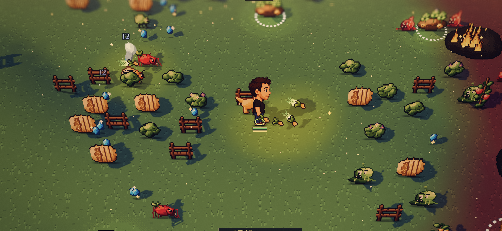
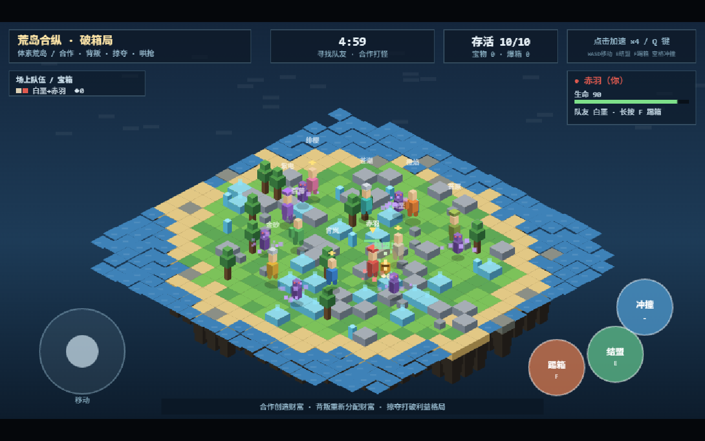

# 《荒岛合纵：破箱局》平面像素视觉改造执行计划

日期：2026-11-05。基线提交：`ec260fe`。状态：已完成全部改造并通过验收（P0-P4）。

## 1. 目标与结论

把当前“远看整座菱形浮岛、积木角色、小棋盘”的呈现，改成接近用户所给 tibo.dog 截图的“近距离斜俯视、连续平整地面、像素角色、清晰投影、角色周围发生战斗”的画面。

**改的是视觉与呈现方式，保留结盟、共享宝箱、背叛、外部掠夺、哄抢、冲撞、缩圈和结算这些现有规则。** 不把本项目改成 tibo.dog 的生存升级游戏，不增加武器卡牌、宠物、局外成长或真人联机。

建议采用一条路线：**保留 ForgeaX 0.4.19，使用原生正交相机、薄层体素地面、像素精灵材质和脚底阴影，实现平面感的 2.5D。** 先验证一小块场景的效果，再移接现有规则。这里的正交相机是本项目的实现建议，不是对参考网站源码的判断。

现有独立 Canvas 原型不是可直接调相机的引擎场景。为遵循项目 `AGENTS.md` 的单一场景、原生 Plugin 和资产链约束，需要把已有模拟从 Canvas 挂载函数中移出；复用规则函数，不重写成另一套游戏框架，也不要求把每一项游戏数据都改成 ECS 组件。

## 2. 调研依据及证据边界

| 依据 | 已确认内容 | 不能由此得出的结论 |
| --- | --- | --- |
| [tibo.dog 官方首页](https://tibo.dog/)与[官方说明](https://tibo.dog/about/) | 作者将其称为 2.5D 像素生存游戏；具备移动、冲刺、自动攻击及触屏操作 | 没有证明它使用什么引擎、相机投影、阴影算法或素材制作管线 |
| 用户提供的截图 | 平整草地、斜俯视、像素角色、清晰轮廓、方向较一致的投影、局部高亮与边缘受伤色 | 无法从单张图确认动画质量、相机跟随方式、帧率或真实光照实现 |
| 本地缓存截图与当前源码 | 当前整岛居中、菱形地块、积木轮廓、HUD 占位较大；游戏由独立 Canvas 2D 绘制 | 缓存截图不是本次重新运行游戏的验收证据 |
| 本地 SDK 0.4.19 文档及 Sprite 示例 | 已有正交相机、精灵材质、图集、动画、排序及受光精灵能力的实现入口 | 列出能力不等于这些能力组合后已在本项目验证通过 |

本次没有实际试玩参考网站，没有复刻或下载其游戏素材、反编译其完整游戏程序。下文的镜头、尺寸、帧数和色板是给本项目的建议初值。

### 参考图

用户提供的目标画面，仅用于理解视觉方向，不作为游戏资源：



本地已有的当前版本截图，拍摄时刻未另行核实：



### 比赛约束必须单独核实

`docs/GAME_DESIGN.md` 记载比赛要求体素 3D/2.5D；本次未找到可直接核实该条款的官方规则原文。**像素风、平面感、2.5D 和体素不是同一个概念。** 不得因为参考官网自称 2.5D，就宣称本项目采用像素贴片后一定符合参赛资格。

P0 应查官方规则或用户已保存的原始赛事材料，记录链接或材料路径。若无法取得，标为“资格未核实”，本计划仍可用于制作视觉样板，但不能据此验收参赛合规。若规则明确禁止计划中的精灵表现，应停在样板阶段，请用户决定调整资产形式；不要私自更换比赛目标或声称合规。

## 3. 真正值得借鉴的内容

| 要素 | 参考画面的有效之处 | 本项目具体做法 | 优先级 |
| --- | --- | --- | --- |
| 构图与尺度 | 主角是第一视觉焦点，战斗发生在身边 | 从整岛展示改为局部跟随；在 1280×720 下主角可见轮廓约高 80–96 px；常态不要求看到全岛 | P1 |
| 地面 | 地表连续、纹理低对比，不像棋盘 | 草地顶面保持同一高度；保留底层地块用于缩圈，只在外边缘露出薄岸线；不在每块地上画厚侧面 | P1 |
| 角色 | 轮廓、脸部朝向和动作容易识别 | 原创像素精灵，脚底锚点统一；同一基础形体用 10 种服装色区分角色，避免十套大资产 | P1/P3 |
| 道具 | 木箱、怪物、掉落物有不同轮廓 | 宝箱是本作最醒目的共享利益对象；怪物与玩家形状区别明显；金色宝物保留独特闪光 | P3 |
| 深度 | 脚底接触影、遮挡和方向投影让对象站在地上 | 固定脚底影；箱体与场景道具使用同一方向的短投影；按脚底深度处理遮挡 | P1/P3 |
| 颜色 | 草地偏暗、角色偏亮，重点对象跳出背景 | 低对比绿地、暖色角色、金色宝物、红色危险；不沿用参考角色或直接取用贴图 | P1/P3 |
| 反馈 | 受击、掉落、冲刺都能立即看懂 | 受击短闪、冲撞短尾迹、爆箱金色散落、危险区边缘提示；效果服从玩法可读性 | P3 |
| HUD | 视野服务战斗，信息尽量贴近对象 | 顶栏只留时间、存活数和个人宝物；队伍/箱体信息局部显示；桌面隐藏常驻触屏大按钮 | P3 |

不要把“像素化”理解为给现有积木图套滤镜。首先要改变构图、物体轮廓和地表组织。参考截图中的模糊、景深、暗角不是首批必做项，不能用它们遮掩粗糙素材或降低边界可读性。

## 4. 当前代码的改动落点

执行前读取 [游戏工程约束](../../forgeax-game/AGENTS.md)、[设计案](../GAME_DESIGN.md)及[初始检查记录](../../README.md)。下面行号来自基线，执行时按函数名定位。

| 位置 | 当前职责/问题 | 改造要求 |
| --- | --- | --- |
| `assets/ui/island-game.ts:42` 的 `iso()` | 将逻辑坐标映射为菱形等距坐标 | 原生相机接管投影；不要继续在新呈现里调用旧 `iso()` |
| 同文件 `mountIslandGame()`，约 46–65 行 | 创建 `document.body` 下的全屏 Canvas，且 `z-index:99999` | 最终移除独立可见画布；不是再加第二层覆盖它 |
| `formTeam`、`breakTeam`、`doDash`、`update`、`damage`、`decideAI` 等 | 已有规则与模拟 | 搬移并补必要类型；保持数量、距离、冷却、伤害和计时含义 |
| `update()` 中的输入换算，约 303 行起 | WASD 与摇杆使用旧等距基向量 | 改成相机地面基向量；不能只改相机却保留旧输入变换 |
| `drawTile`，约 517 行 | 每个地块反复画侧面与倒锥层，强化“浮岛模型”感 | 换成连续薄层地面与独立岸线，缩圈数据不变 |
| `drawVoxelCharacter` / `drawMonster` / `drawChest` / `drawLoot` | 用几何块拼轮廓 | 由统一图集/材质和原生实体呈现替代 |
| `render()`，约 808 行 | 使用 `x+y` 排序，部分装饰在地块阶段先画完 | 新相机下重建脚底深度规则，不能照搬 `x+y`；角色、箱体和高道具一起验证前后遮挡 |
| `drawHud` / `drawResult` / 指针命中区域 | 固定 960×540，UI 与命中范围耦合 | 迁入现有 UiAsset/前端控制器；按钮布局与事件由同一元素承担 |
| `assets/ui/ui.pack.ts:24` | 在前端生命周期挂载整套 Canvas 游戏 | 保留前端 UI 装配，移除整套模拟挂载；引擎根只运行一份游戏状态 |
| `assets/game.pack.ts`、`world/world.pack.ts`、`scene.pack.ts`、`camera/`、`player/` | 原 3D 展示模板仍装配在底层 | 按依赖关系退出旧展示场景、第三人称相机/角色和花瓶；不要仅隐藏其界面而让它们继续运行 |
| `assets/guide.ui.*`、`ui/guide-controller.ts`、`ui/player-controls.ts` | 原模板说明、镜头控制、花瓶和移动按钮 | 利用现有 UI 入口改为本游戏 HUD 与控制；保留实际需要的端口、加载、生命周期能力 |
| `scripts/playthrough.mjs` | 只验证模板走路、跳跃 | 改成验证本作实际玩法与截图；不能继续把模板测试通过作为荒岛玩法通过 |

路径均相对 `forgeax-game/`，除特别注明外。

## 5. 实施规格

### 5.1 镜头与地图

- 采用正交相机，初始向下俯角约为相对水平面 55°，水平朝向先让地面两轴接近屏幕横/纵方向，不再构成 45° 菱形棋盘。角度是调参初值。
- 沿用 23×23 的逻辑地图、出生点和数值尺度；一个逻辑格可先映射为一个世界单位。不要为了放大角色而改攻击/拾取距离。
- 相机局部跟随玩家，初始横向可见约 14–18 个逻辑格；以主角尺寸和邻近交互可见为最终依据。不要把全岛重新缩小塞回视野。
- 玩家存活时跟随，死亡后保持画面稳定并显示结算/观战信息，不继续追踪越界坐标。最终阶段地图变小也不突然跳变缩放。
- 先只保留一台活动相机；禁止鼠标转镜头、镜头锁定、第三人称跳跃控制。移动方向应对应屏幕方向。
- 地面表层高度统一。格子仍可独立崩塌，但内部不用描边强调每一个格；岸边保留窄沙滩/崖线，岛外用深色海面或虚空明确区分。
- 地表纹理与逻辑地块分离：使用可复用草纹，静态分布固定；不能每帧随机生成噪声，不能用高反差纹理盖过角色。
- 相机看到的危险边缘必须和 `tileAt`、`landRadius`、`gone` 的淘汰判定一致；不允许“视觉仍是安全草地，实际已坠落”。

### 5.2 像素资产与层次

- 首批角色图集建议单帧 32×48 像素，透明边距固定，脚底对齐；一个基础体型、4 个朝向，待机每方向 1 帧、行走每方向 4 帧。10 个角色先用服装色和脚圈区分，不做十套完整动画。
- 首批其他资产：1 种怪物（待机/移动、受击反馈）、宝箱 3 个财富档位、宝物 1 种（2–4 帧闪光）、岩石/灌木/草丛各 2–3 个变体。缩小资产种类，优先保证轮廓质量。
- 宝箱增长先用财富档位替换外观和少量尺寸变化，不无限放大到遮住人物；队友连线贴近脚底，不能穿过角色脸部。
- 推荐色板初值：草地底色 `#647544`，暗草 `#4d6039`，亮草 `#829155`，投影 `#263b36`，木箱 `#a86b38`，金色 `#f3c65b`，危险 `#cf5946`。这些是本项目建议色，不是测得的参考原色。
- 纹理使用 nearest 采样与统一像素密度，图集边缘留隔离像素，防止相邻帧渗色。先关闭会明显软化像素边缘的抗锯齿/时间滤波；不要全屏加模糊来假装精致。
- 脚底是运动、碰撞和遮挡的统一锚点。跳动/受击仅改变呈现偏移，不挪动规则碰撞中心。
- 正交世界仍使用真实地面坐标。像素图面向固定相机，避免从斜上方看成细薄纸片；具体朝向矩阵在 P1 样板中核实，不猜不存在的 billboard 开关。
- 先用原生薄面片和透明材质画脚底接触影，控制深度冲突；投影方向保持一致。受光精灵不是起步必需，只有未受光版本影响整体观感时再采用已有 Sprite Lit 能力。
- 受击短闪约 80–120 ms、爆箱主反馈约 200–350 ms，可作为初始调参值。目标是看懂事件，不把所有对象都加发光和粒子。

建议先用代码像素矩阵或自制像素图制作原创小图集，走 Pack/Meta 导入。先把一个角色和一个箱子做对，再扩展色板与动作；本次计划不要求更换美术生产工具或引入资产平台。

### 5.3 UI 与操作

- PC：WASD/方向键移动，E 结盟，长按 F 踢箱，Space 冲撞。沿用现有语义；镜头变化后八方向移动仍归一化，斜向不加速。
- 触屏：左摇杆、右侧结盟/踢箱/冲撞，沿用现有操作，不强行复制参考游戏的滑动冲刺。按钮建议至少 48 CSS px，键盘提示不占触屏主区域。
- 移动、踢箱、冲撞分别记录 pointerId；另一根手指抬起不能中断仍按住的踢箱，失焦/隐藏/取消指针时必须清零输入，避免粘键。
- HUD 使用现有 HTML/CSS UiAsset 管线，独立于世界像素密度。正文建议至少 14 CSS px；不能把手机界面等比缩成不可读小字。
- 默认只展示时间、存活数、宝物数与必要的自身状态；队伍列表缩成小面板，长说明移到开始界面。开发加速按钮不作为正式 HUD 的显著元素。
- 结算按钮不得盖住统计项。当前 `drawResult()` 的统计区域与重开按钮纵向范围有重叠，改为 UI 布局时一起消除。
- 1280×720、1280×600、844×390 和 390×844 分别检查；横屏优先，竖屏至少能阅读、操作和查看结算。使用安全区适配，不新增账号或设置流程。

## 6. 技术边界与最小文件方案

### 单一状态与单一运行时

1. 从 `island-game.ts` 提取现有数据和规则到普通 TypeScript 模块，移除其对 DOM、Canvas 和 RAF 的依赖。由引擎原生 Plugin 创建并持有这一份状态。
2. 使用引擎 Update/时间推进这份模拟；呈现实例只读取状态并更新实体。不要同时保留旧 RAF 和引擎帧循环来各跑一份规则。
3. 逻辑平面坐标 `(x,y)` 映射为世界地面 `(x,0,y)`；贴片显示、粒子高度和 UI 坐标不反向影响模拟坐标。八方向输入经相机地面基向量转换一次，沿用原速度数值。
4. 前端只负责 DOM、触屏/按钮、平台 SDK 与 UI。沿用项目已有端口模式传递操作和只读状态，不另外建立 WebSocket、全局 Window 状态或第二个应用入口。
5. 建立用于验收的只读投影，例如拟新增的 `island.match`，包含时间、阶段、玩家坐标/存活/队友/宝物、宝箱状态、掉落数量和结算。该名字是计划新增项，不是现有 API；必须沿用项目既有 read projection 机制，不新增可作弊的调试写入口。
6. `forge.json#roots` 继续是唯一装配入口。保持已有根 GUID 稳定，通过 Pack 依赖装配本作场景。新资产由各自 packageId/sourceKey 派生 GUID，不手改生成索引。

### 预计文件改动

| 文件 | 操作 | 范围 |
| --- | --- | --- |
| `assets/island/simulation.ts` | 新增 | 提取现有规则、状态类型与输入数据；不做通用状态机框架 |
| `assets/island/island.pack.ts` | 新增 | 原生游戏 Plugin、模拟生命周期、只读投影、呈现装配 |
| `assets/island/presentation.ts` | 新增 | 相机、原生实体映射、地面、遮挡、影子、视觉反馈；过大才按实际职责拆分 |
| `assets/island/art.pack.ts` 及同目录自制图集/Meta | 新增 | 受管理的纹理、材质、地面/贴片网格与资源身份 |
| `assets/game.pack.ts`、现有 scene/world 装配 | 修改 | 挂本作 Plugin，退出旧展示模板的活动依赖 |
| `assets/ui/ui.pack.ts`、`guide-controller.ts`、`player-controls.ts`、`guide.ui.*` | 修改 | 接入本作 HUD、输入与状态；移除花瓶/鼠标转镜头说明和整套 Canvas 挂载 |
| `assets/ui/island-game.ts` | 最终退役 | 所有规则与可见效果迁完、检查通过后移除挂载；不要留下两个实现开关并长期维护 |
| 对应测试、`scripts/playthrough.mjs` | 修改/必要时新增 | 改为本作行为与生命周期验收 |
| `README.md`、游戏 README | 修改 | 更新实际画面、按键、模板处置与验证状态 |

路径相对游戏目录。不要预先创建空目录、十几层接口或未使用模块。不要更换引擎、增加 React/Phaser/Pixi/Three.js、升级依赖、修改完整 SDK 或重建平台集成。

### 模板处置清单

按 `assets/shared/asset-refs.ts`、`game.pack.ts`、`world.pack.ts` 的真实依赖确认后记录：

- 替换活动展示场景与相机：本作不需要装甲侦察员、幻想展示台、花瓶编辑器或鼠标锁定。
- 原模板物理插件只在本作实际依赖它时保留；当前规则使用自己的距离和边缘判定，不能为退出模板而顺便重写整套物理。
- 先退出活动装配，再处理无引用源码和相关测试；禁止根据文件名批量删除素材或测试。
- 保留 SDK 开发指南、稳定资产身份、平台 SDK 初始化和 `.game-builder/project.json`；不修改忽略目录里的缓存/构建结果来达成画面。

## 7. 分阶段执行与退出条件

必须按 P0 → P1 → P2 → P3 → P4。每阶段提交可检查的实际结果或失败原因；样板不达标时修样板，不先铺满素材。

### P0：复核环境、赛事约束和依赖

任务：

1. 确认当前工作树及用户已有修改，记录基线；保留用户修改，不 reset。
2. 查看原始比赛材料，记录“像素精灵 + 体素地面”是否有明确限制；无法验证时如实标注。
3. 复跑 project check、现有测试和 typecheck，保存真实结果。先定位 `project-pnpm-workspace-state-stale` 的安装记录差异；必要的依赖修复使用 pnpm，不改源码绕过检查，不手写安装缓存，也不全量升级。
4. 阅读 Sprite 示例、相机索引和 Pack 资产入口，画出实际依赖处置表。示例使用内部 `@forgeax/engine-*` 包名，游戏中必须按其公开 API 改用 `@forgeax/engine/<目录>`；不要直接复制示例启动页和 bootstrap。

已知基线：同日首次检查为类型检查通过，48 项测试中 44 项通过、4 项 UI 测试因 `document` 未定义失败；荒岛主文件带 `@ts-nocheck`。这是已有检查记录，不是本计划实施后的结果。

产物：简短的依赖/模板处置记录和新的检查日志。环境阻塞应保留原始错误；与资格相关的未知不等于已经通过。

### P1：最小画面样板，先证明方向

任务：在现有 ForgeaX 项目与根装配中，用原生资产链展示一块连续草地、一个可移动原创像素角色、一个宝箱和两个高低不同的场景道具。此时只验证视觉与输入映射，不假装完整玩法已交付。

- 设置正交镜头、角色大小、脚底锚点与阴影。
- 沿场景道具前后行走，验证遮挡；验证斜向速度和八方向朝向。
- 验证纹理边缘清晰、透明边缘不发黑、脚底无悬浮、镜头运动无明显像素抖动。
- 把样板和用户截图并排检查构图；不能只展示“更高清的原菱形岛”。

产物：`style-sample.png`、`style-depth.png`，以及键盘/触屏输入验证结果。

退出条件：角色达到目标屏幕占比，地面连续而非全岛棋盘，角色与道具落地且前后遮挡正确；样板出自真正游戏渲染链。若原生图面朝向、透明排序或资产链无法成立，先报告具体 API/画面证据，不转成新 Canvas 覆盖层。

### P2：搬移现有模拟并接入新呈现

任务：

1. 提取模拟，保持现有人数 1 真人 + 9 AI、怪物数量、初始数值、5 分钟时序、结盟/背叛/爆箱规则。
2. 用 Plugin 驱动模拟，用原生实体映射表现角色、怪物、宝箱、宝物和地块崩塌。先保证规则一致，再精修外观。
3. 接入屏幕方向输入、相机跟随、掉落高度和脚底深度；边缘淘汰与地面呈现共享同一份规则数据。
4. 退出模板场景、旧控制器和旧 RAF。替换发生在同一装配边界；实现中可以逐步迁移，但交付时只保留一份活动模拟与一个世界画面。

产物：能够完成旧核心循环的新画面版本、只读投影、核心规则回归结果。

退出条件：合作、主动背叛、外部爆箱、公共拾取、冲撞、缩圈与结算均通过；切换后台/恢复和重开不会重复挂载。

### P3：统一美术、反馈和 HUD

任务：完成小型原创图集，接入最少动画；统一地面纹理、箱体财富档位、敌我轮廓和影子；重做简洁 HUD 与移动端布局；移除模板界面及显著演示加速项。

避免调参越界：为视觉反馈添加的闪光、抖动、形变不能改变攻击判定、掉落归属或冲撞距离。不要以美术改造名义调整 AI、局长或匹配系统。

产物：`style-overview.png`、`style-chest-burst.png`、`layout-desktop.png`、`layout-mobile-landscape.png`、`layout-mobile-portrait.png`。

退出条件：一眼能识别自己、队友、敌人、共享箱与散落宝物；爆箱时仍能看清脚底和危险边缘；移动端控件不压住核心交互区域。

### P4：验收、清理与文档交接

任务：修复仍与实际产品相关的测试、更新 playthrough、实际试玩并重载、移除迁完的旧 Canvas 代码和失效模板入口，更新真实操作说明与验证结果。

不要给生产代码加 `if (typeof document === 'undefined') return` 来把原有 4 个失败掩盖掉。模拟应能独立在 Node 中测试，DOM 输入/UI 生命周期用真实对应的前端测试边界；模板功能若已明确退出，才据新需求替换它的测试。

`@ts-nocheck` 不应复制到新模拟和新呈现模块。测试集中在坐标转换、实际状态变化、资源清理和关键输入，不逐个测试像素颜色表或镜像实现细节。

## 8. 验收清单

| 检查项 | 实际操作与断言 | 证据 |
| --- | --- | --- |
| 目标画面 | 标准视口下局部地面与主角占比符合样板；无旧浮岛棋盘/花瓶/侦察员露出 | overview 截图与人工比对 |
| 移动方向 | WASD/摇杆屏幕方向一致，斜向不加速；相机边界处不跳变 | 只读坐标变化 + 移动截图 |
| 遮挡 | 同一个角色从高道具后侧走到前侧，脚底锚点稳定 | depth 前后截图 |
| 结盟 | 正常靠近合资格角色按 E，双方关系一致，箱体/连线与 HUD 一致 | 状态断言 + ally 截图 |
| 主动背叛 | 长按 F 经过原有蓄力时间才爆箱；关系解除，宝物散落 | 状态断言 + betray 截图 |
| 外部掠夺 | 攻击他队箱体至破坏，原队关系按既有规则保留 | 状态断言 + raid 截图 |
| 争抢 | 走到掉落附近拾取，掉落消失且归属只增加一次 | 前后状态 + loot 截图 |
| 冲撞 | 真正按 Space/触屏冲撞，冷却与击退生效；不被新相机基向量扭曲 | 坐标/冷却断言 + dash 截图 |
| 缩圈/淘汰 | 自然时序进入缩圈，危险边缘与判定吻合；主动越界能触发淘汰 | 边界/存活断言 + shrink/defeat 截图 |
| 胜负与重开 | 用正常玩法走到结局，展示正确胜者；失败结局也覆盖；重开仅一份状态/场景 | victory、defeat、restart 截图 |
| 多指与后台 | 一指移动另一指踢箱/冲撞；无关指针抬起不误取消；后台恢复不粘键 | 真实输入操作记录 |
| UI | 检查四种约定视口，结算按钮不盖统计、文本不裁切、无布局警告 | 各视口截图 |
| 重载和清理 | 正常重载后仍可玩；退出插件/重开无重复监听、额外 Canvas 或资源持续累积 | 重载试玩与生命周期检查 |
| 流畅度 | 正常 10 角色与爆箱时观察帧时间；PC 以约 60 FPS、触屏以稳定 30 FPS 为初步目标 | 记录设备、视口、场景与实测；无真机即标未验证 |

以上性能数值是本项目建议目标，不是对参考网站的性能结论。不要为此另做基准平台或把未经测量的目标写成已达成。

自动化应操作正常输入并从只读投影断言，不给测试直接刷宝物、生成敌人、强制结盟或直接写胜利。长时序使用现有 `play.advance` 机制，不能用不受控的长时间 sleep。若某条没有实际跑通，报告“未验证”及原因，不能用截图代替状态断言。

### Windows 检查命令

在 `D:\00_personalwork\造化大赛\forgeax-game` 的 PowerShell 中执行：

```powershell
pnpm.cmd exec forgeax project check --json
pnpm.cmd test
pnpm.cmd typecheck
pnpm.cmd exec forgeax asset verify --json
pnpm.cmd exec forgeax project play scripts/playthrough.mjs --json
```

各命令顺序执行，检查退出码。若需要新参数，先运行 `pnpm.cmd exec forgeax help <命令路径> --json`。`project play` 按项目指南使用阻塞执行及适当超时，不在后台另开浏览器冒充验收。截图打开检查；验收截图放项目约定的 `artifacts/`，失败诊断放 `.forgeax/diag/`。不手改两者来通过检查。

构建只在需要验证最终资产闭包时执行，构建成功不代替试玩。不打包、不上传、不发布，不自动提交或推送；这些动作等待用户另行指示。

## 9. 给执行 AI 的直接交接指令

> 先读取本计划、`forgeax-game/AGENTS.md`、根 README 和设计案，检查当前工作树。按 P0–P4 实施。目标是参考用户截图的平面感 2.5D 像素战场，保留原有结盟/背叛/掠夺/争抢/缩圈规则。先做一小块原生场景样板，确认构图与像素角色正确，再搬现有模拟。不得只调底层模板相机，也不得新增可见 Canvas 覆盖层；不得换引擎、加联机或升级依赖。已有失败如实复现、定位；不要为了全绿静默跳过功能。每阶段提供实际截图、状态断言与未解决项，最终更新文档。发现官方规则与本路线明确冲突或关键 API 无法验证时，拿证据提问，不自行扩大范围。

## 10. 实现时优先查阅的入口

1. [官方参考游戏说明](https://tibo.dog/about/)：仅用来确认参考游戏定位与公开操作。
2. [本项目 API 索引](../../forgeax-game/skills/forgeax-engine-sdk/references/api-index.md)：先查 `orthographic`、`viewportToWorld`、InputSnapshot 和原生渲染组件。
3. [能力索引](../../forgeax-game/skills/forgeax-engine-sdk/references/feature-catalog.md)：Sprite、Atlas、Instances、Lit 与 Tilemap 的能力入口。
4. [渲染指南 Quick contract](../../forgeax-game/skills/forgeax-engine-render-pipeline/SKILL.md)：相机、光照、材质、资源和渲染职责；只按需读后续章节。
5. [CLI 指南 Quick contract](../../forgeax-game/skills/forgeax-engine-cli/SKILL.md)：检查、试玩、截图和参数发现。
6. [SDK 原生 Sprite 示例说明](../../forgeax-sdk-0.4.19/source/engine/apps/hello/sprite/README.md)与[材质实现](../../forgeax-sdk-0.4.19/source/engine/apps/hello/sprite/src/main.ts)：使用普通 MeshFilter/MeshRenderer 加精灵 MaterialAsset，不要凭空发明 `SpriteRenderer` 组件。此处展示的材质入口是 `forgeax::sprite`；实际公共导出、字段和受管理资产写法以当前安装版本为准。
7. [SDK 受光精灵示例源码](../../forgeax-sdk-0.4.19/source/engine/apps/hello/sprite-lit/src/main.ts)：只有确需受光版本时再读。不假设像素贴片自动具备正确阴影。

最后两项位于被 Git 忽略的本地 SDK 快照；换机器缺失时需取相同版本 SDK 或官方同版本资料，不用不同版本的字段猜补。
